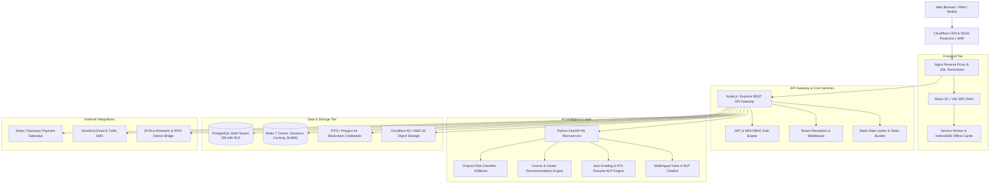

# UniCore Enterprise ERP — SaaS & System Architecture

## 1. High-Level Architecture Overview

UniCore ERP is architected as an **Enterprise Multi-Tenant Micro-SaaS Platform** designed to serve dozens of universities and colleges with strict data isolation, high scalability, and sub-100ms response latencies.



---

## 2. Multi-Tenant Architecture & Data Isolation

### 2.1 Tenant Resolution Pipeline
UniCore supports 3 distinct tenant routing mechanisms:
1. **Subdomain Resolution**: `mit.unicore.edu` or `harvard.unicore.edu` mapped dynamically via DNS wildcard CNAME.
2. **Custom Domain**: `portal.cambridge.ac.uk` routed with TLS via SNI proxy and tenant ID lookup in Redis cache.
3. **Tenant Header / Token Context**: `X-Tenant-ID` header supplied by the frontend client based on active session.

### 2.2 PostgreSQL Row-Level Security (RLS)
To guarantee cryptographic and logical separation between collegiate tenants without the overhead of individual databases per client:
```sql
-- Enable RLS on core entities
ALTER TABLE students ENABLE ROW LEVEL SECURITY;
ALTER TABLE marks ENABLE ROW LEVEL SECURITY;
ALTER TABLE fee_transactions ENABLE ROW LEVEL SECURITY;

-- Tenant Isolation Policy
CREATE POLICY tenant_isolation_policy ON students
    FOR ALL
    USING (tenant_id = current_setting('app.current_tenant_id', true)::uuid);
```
Every request arriving at the API gateway sets `SET LOCAL app.current_tenant_id = '...'` within the database transaction, preventing cross-tenant leakage even in the case of SQL injection attempts.

---

## 3. AI Intelligence Suite Architecture

### 3.1 Student Dropout Risk & Early Warning
* **Model**: Gradient Boosted Trees (XGBoost / LightGBM)
* **Feature Vectors**: 
  - Attendance trends (rolling 14-day and 30-day slopes)
  - Continuous internal assessment scores (deviation from class median)
  - LMS engagement frequency & assignment submission punctuality
  - Fee payment delay metrics
* **Output**: Risk classification (`LOW`, `MEDIUM`, `HIGH`, `CRITICAL`) with confidence intervals and suggested early interventions for academic counselors.

### 3.2 NLP Auto-Grading & ATS Resume Analyzer
* **Embedding Model**: `text-embedding-3-small` / Sentence-Transformers
* **Cosine Similarity Engine**: Evaluates student submissions against rubric answer keys, providing semantic matching, keyword density scoring, and hallucination prevention.
* **Plagiarism Fingerprinting**: MinHash + LSH algorithm against university essay repository.

### 3.3 Blockchain Tamper-Proof Credentials
* **Standard**: ERC-721 / ERC-1155 on Polygon Proof-of-Stake Network
* **Metadata**: Stored on decentralized IPFS with SHA-256 cryptographic hash of degree transcripts
* **Verification**: Zero-knowledge and instant public QR code lookup requiring no login credentials.

---

## 4. Security & Compliance

| Security Dimension | Implementation Standard |
|---|---|
| **Authentication** | JWT with 15-min Access Tokens & 7-day HttpOnly Refresh Cookies |
| **MFA Support** | RFC 6238 TOTP (Google Authenticator), WebAuthn / FIDO2 Passkeys |
| **Audit Trails** | Immutable append-only audit log with SHA-256 parent hash chaining |
| **Compliance** | FERPA, GDPR (Article 17 right to erasure), ISO 27001, SOC 2 Type II |
| **Data Encryption** | AES-256 at rest, TLS 1.3 in transit with strict HSTS |

---

## 5. Micro SaaS Subscription & Billing Tiers

UniCore SaaS delivers 4 scalable subscription tiers:
- **Starter ($499/mo)**: Up to 1,000 active students, core academic ERP modules.
- **Growth ($1,499/mo)**: Up to 5,000 students, includes AI Predictive Analytics, Placement Portal, Parent Portal.
- **Enterprise ($3,499/mo)**: Unlimited students, white-label branding, custom domains, blockchain credentials, 99.99% SLA.
- **Global University ($5,999/mo)**: Multi-campus federation, dedicated database instance, on-premise AI inference options.
