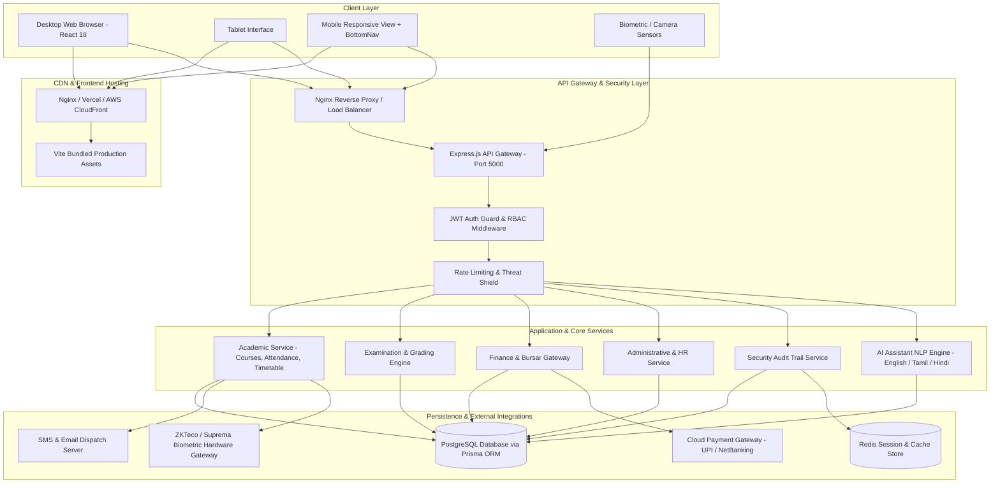
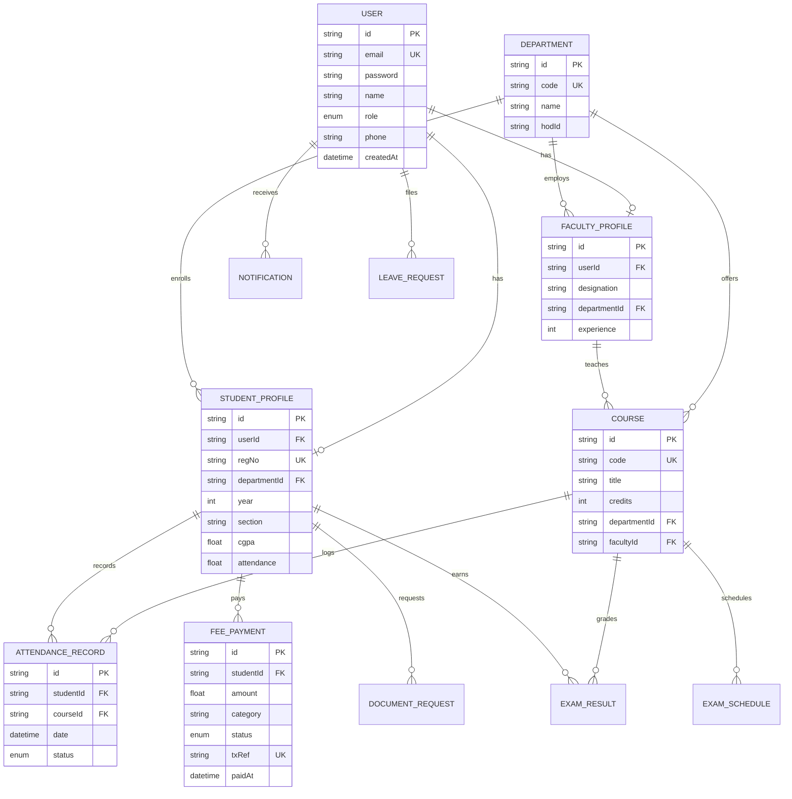

# UniCore ERP — Master Architecture, Database ER & Technical Specification

This document provides the complete system architecture, database entity-relationship schema, API specifications, component layout, and deployment procedures for **UniCore ERP**.

---

## 1. Full System Architecture Diagram



---

## 2. Database Entity Relationship (ER) Diagram



---

## 3. Complete Folder Structure

```
final ERP/
├── docs/
│   └── SYSTEM_ARCHITECTURE.md
├── server/
│   ├── middleware/
│   │   └── auth.js             # JWT & RBAC authorization middleware
│   ├── prisma/
│   │   └── schema.prisma       # Relational database models
│   └── server.js               # Express API with AI Chatbot endpoints
├── src/
│   ├── components/
│   │   ├── chatbot/
│   │   │   └── ChatbotWidget.jsx   # Multi-language voice/text AI assistant
│   │   └── layout/
│   │       ├── BottomNav.jsx       # Mobile bottom navigation tabs
│   │       ├── Layout.jsx          # Responsive desktop/mobile shell
│   │       ├── Sidebar.jsx         # Role-based dynamic sidebar
│   │       └── TopBar.jsx          # Search, theme toggle, role switcher
│   ├── context/
│   │   ├── AuthContext.jsx         # Persistent demo & token auth
│   │   ├── ChatbotContext.jsx      # NLP intent matcher (EN, Tamil, Hindi)
│   │   └── ThemeContext.jsx        # Glassmorphic light/dark mode
│   ├── data/
│   │   └── mockData.js             # Production campus datasets & FAQ
│   ├── pages/
│   │   ├── Login.jsx               # Single-click 4-role demo login
│   │   ├── dashboards/
│   │   │   ├── AdminDashboard.jsx
│   │   │   ├── Dashboard.jsx
│   │   │   ├── FacultyDashboard.jsx
│   │   │   ├── ParentDashboard.jsx
│   │   │   └── StudentDashboard.jsx
│   │   └── modules/
│   │       ├── AlumniManagement.jsx
│   │       ├── AttendanceManagement.jsx   # Biometric & face check-in
│   │       ├── AuditLogs.jsx              # Security audit trail
│   │       ├── DepartmentManagement.jsx
│   │       ├── DocumentRequests.jsx       # E-signed certificate generator
│   │       ├── EventsClubs.jsx
│   │       ├── ExaminationResults.jsx
│   │       ├── FacultyManagement.jsx
│   │       ├── FeesPayment.jsx
│   │       ├── LeaveODManagement.jsx
│   │       ├── Notifications.jsx
│   │       ├── ParentPortal.jsx           # Dedicated parent portal
│   │       ├── PlacementPortal.jsx
│   │       ├── Settings.jsx
│   │       ├── StudentManagement.jsx
│   │       └── TimetableManagement.jsx    # Heuristic AI schedule generator
│   ├── App.jsx                     # Central router & protected route guards
│   ├── index.css                   # Premium CSS design tokens & animations
│   └── main.jsx
├── package.json
└── vite.config.js
```

---

## 4. API Endpoints Specification

| Method | Endpoint | Access Role | Description |
| :--- | :--- | :--- | :--- |
| `POST` | `/api/auth/login` | Public | Authenticates credentials, returns JWT token |
| `GET` | `/api/auth/me` | Authenticated | Fetches profile of currently authenticated user |
| `POST` | `/api/ai/chat` | Authenticated | Contextual AI student assistant endpoint |
| `GET` | `/api/students` | Admin, Faculty | Paginated student registry with GPA & attendance |
| `POST` | `/api/attendance/checkin` | Hardware API | Biometric/Face recognition check-in gateway |
| `GET` | `/api/fees/balance` | Student, Parent | Detailed outstanding balances & receipt history |
| `POST` | `/api/fees/checkout` | Student, Parent | Initiates online PG payment transaction |
| `POST` | `/api/leave/apply` | Student | Submits medical or on-duty leave with attachments |
| `PUT` | `/api/leave/review/:id` | Faculty, Admin | Approves or rejects student leave applications |
| `GET` | `/api/audit/logs` | Admin | Immutable system security and activity log stream |

---

## 5. Deployment Procedures

### Production Build & Static Hosting
```bash
# 1. Install dependencies
npm install

# 2. Build production assets
npm run build

# 3. Output files located in /dist
# Serve via Nginx, AWS S3 + CloudFront, or Vercel
```

### Backend API Server (Node.js & Prisma)
```bash
# In the server directory
cd server
npm install express cors dotenv jsonwebtoken prisma @prisma/client

# Apply database migrations
npx prisma migrate dev --name init

# Start production API
node server.js
```

---

## 6. Micro-SaaS & Multi-Tenant Architecture

UniCore ERP operates as a horizontally scalable B2B Micro-SaaS platform supporting multi-tenant institutional partitioning:

1. **Tenant Isolation Model**:
   - Each tenant is identified by a unique `tenant_id` (e.g., `tnt_mit_01`, `tnt_bms_02`).
   - Tenant resolution occurs via custom subdomain mapping (`mit.unicore.edu`), JWT payload claims, or header context.
   - Separate tenant schemas or row-level security (RLS) partition institutional data (students, faculty, financial ledgers).

2. **SaaS Subscription Tiers & Billing Lifecycle**:
   - **Starter Pilot ($850/mo)**: 1,000 student licenses, core academic ERP.
   - **Growth Tier ($2,200/mo)**: 3,500 student licenses, AI scheduling & multi-language chatbot.
   - **Enterprise University ($5,000/mo)**: 10,000+ student licenses, AI predictive analytics, course/career recommender, optical face recognition, custom white-labeling, 99.99% SLA.

3. **Super Admin Platform Console**:
   - Centralized platform owner dashboard managing cross-tenant revenue (MRR, ARR), active seat capacities, institutional health metrics, and single-click automated tenant provisioning.

---

## 7. AI Predictive Modeling & Recommendation Logic

1. **Student Dropout & Performance Risk Predictor**:
   - **Algorithm**: Supervised gradient boosted trees & ensemble classification (XGBoost / LightGBM) trained on historical student trajectories.
   - **Feature Vectors**: Attendance degradation velocity ($w=0.45$), continuous assessment mark variances ($w=0.35$), LMS engagement frequency ($w=0.20$), and fee delinquency triggers.
   - **Output**: Calibrated dropout probability percentage, early warning risk category (High/Medium/Low), and automated intervention recommendations.

2. **Elective Course & Career Recommendation Engine**:
   - **Course Matching**: Content-based filtering matching historical grade mastery (A/A+ in Algorithms) and prerequisite trees to upcoming semester electives (Machine Learning, Cloud Systems).
   - **Career Pathway Engine**: Profile vector similarity matching student CGPA, completed coursework, and project repositories against current corporate job profiles (e.g. Google Cloud SDE, ML Research Engineer). Provides explicit skill gap bridge roadmaps.

